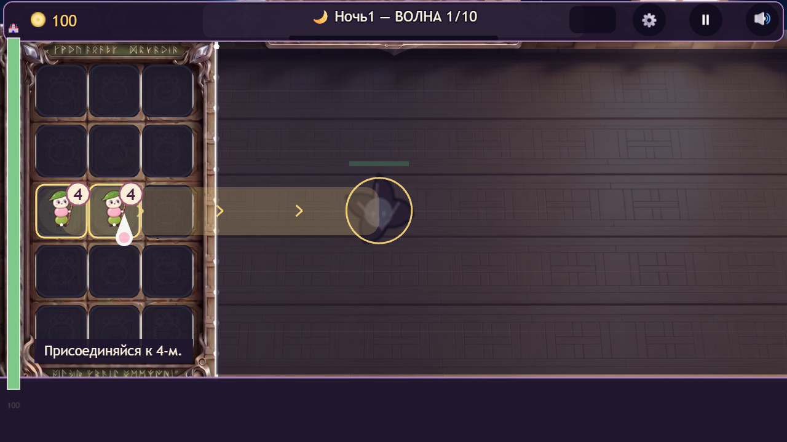
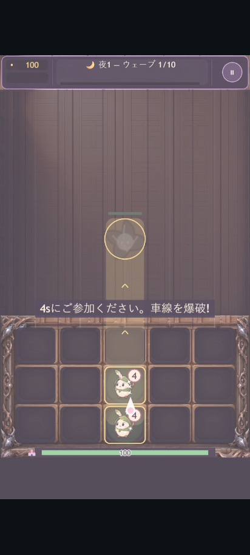

# Mochi Guardians — Arquitectura de Testing y QA

**Responsable de QA:** Jorge · **Juego:** Phaser 3 y TypeScript · **Automatización pública:** JavaScript, Node.js Test Runner y Playwright.

Portfolio de estrategia de pruebas, automatización de navegador, documentación de defectos y evidencias reproducibles de un juego web. Incluye una suite pública ejecutable contra la demo o la versión completa compiladas. El código comercial del juego permanece privado.

## Qué puedes comprobar aquí

| Entregable | Alcance verificable |
|---|---|
| Suite pública de navegador | **10 escenarios parametrizados**: español, inglés, ruso, japonés y chino simplificado × horizontal y vertical |
| Integridad del paquete | **1 comprobación adicional**: HTML y scripts de producción, sin referencias a sourcemaps en los scripts de entrada |
| Preferencia de idioma | Detección inicial, almacenamiento y conservación tras recarga y cambio de orientación |
| Estabilidad del arranque | Canvas visible, adaptación de orientación, errores JavaScript, recursos HTTP fallidos y peticiones externas inesperadas |
| Diseño manual | **28 casos diseñados en 7 áreas**; su ejecución manual está pendiente de registrar |
| Defectos | **5 informes**, con pasos, resultado esperado y observado, causa y alcance de la verificación |
| GitHub Actions | Workflow manual incluido; requiere una URL directa del juego. No se acredita una ejecución remota aprobada |

Son **11 comprobaciones finales por ejecución**: 10 escenarios y una comprobación de paquete. El runner puede mostrar 12 tests porque también cuenta el grupo padre; no son 12 escenarios independientes. Los resultados de demo y versión completa se documentan por separado. Los informes fechados describen la revisión ejecutada; cualquier cambio posterior de la suite requiere una nueva ejecución.

## Navegación y trazabilidad

| Qué revisar | Prueba o documento | Evidencia / estado |
|---|---|---|
| Arranque, idiomas y orientación | [Suite pública](automation/demo-smoke.test.mjs) | [Demo](evidence/2026-10-20/demo-production-results.json) · [Versión completa](evidence/2026-10-20/full-production-results.json) |
| Selector de idiomas | [Informe de regresión](docs/update-2026-10-19.md) | [Capturas y resultados](evidence/2026-10-19/language-picker/) |
| Límite de la demo y separación de guardados | [Informe de integración](docs/release-2026-10-18.md) | [Resultados](evidence/integration/results.json); ejecución en el proyecto privado |
| Acabados de interfaz y recorridos | [Informe de UI](docs/update-2026-10-19-ui-finish.md) | [Capturas y resultados](evidence/2026-10-19/ui-finish/) |
| Estrategia y riesgos | [Plan de pruebas](docs/test-plan.md) | Alcance, entornos y criterios de salida |
| Casos manuales | [7 documentos](docs/test-cases/) | [Registro de ejecución pendiente](docs/test-run.md) |
| Diagnóstico de defectos | [DEF-001 a DEF-005](docs/defects/) | Cuatro verificaciones históricas en código y una corrección de localización verificada por integración |

La suite pública comprueba el arranque y la preferencia de idioma; **no prueba por sí sola el progreso de partida, el combate, los jefes ni el balance**. Las pruebas de integración que necesitan el código privado se identifican como tales.

Última revisión: [recorridos, flores y alcance público del 20/10](docs/update-2026-10-20.md).

## Evidencia visual

| Ruso · horizontal | Japonés · vertical |
|---|---|
|  |  |

Capturas obtenidas con Chromium mediante Microsoft Edge y viewports simulados. Capturar una pantalla no equivale a aprobar automáticamente su diseño ni su traducción.

## Ejecutar la suite pública

Requisitos: **Node.js 22 o posterior** y una URL directa del juego compilado. El juego se obtiene por separado.

```bash
npm ci
npx playwright install chromium
```

En PowerShell:

```powershell
$env:BASE_URL='https://URL-DIRECTA-DEL-JUEGO/'
npm test
```

Para una demo extraída en local, abrir primero otra terminal en este repositorio:

```powershell
$env:DEMO_DIR='C:\ruta\demo-extraida'
npm run serve:demo
```

Usar entonces `http://127.0.0.1:4173/` como `BASE_URL`. En itch.io se necesita la URL del contenido HTML5 del iframe, no la ficha de la tienda.

Opciones: `EDITION=full` para la versión completa, `BROWSER_CHANNEL=msedge` para Edge instalado y `QA_OUTPUT` para cambiar la carpeta de resultados. Por defecto se utiliza Chromium de Playwright y se escribe en `artifacts/latest/`.

La ejecución genera capturas y `results.json`; la terminal muestra el resultado del runner. El [workflow qa.yml](.github/workflows/qa.yml) permite ejecutarla desde GitHub Actions con una URL accesible desde su runner.

## Alcance y límites

- **Cobertura de código no instrumentada:** no se publica un porcentaje.
- Los casos manuales diseñados no se presentan como ejecutados. Los [borradores de Jira](docs/jira.md) no acreditan tickets creados.
- Las pruebas registradas no acreditan dispositivos físicos, Firefox, Safari ni revisión lingüística nativa.
- El [registro histórico de automatización](docs/automation.md) corresponde al proyecto privado y no es el recuento de esta suite pública. La ejecución general privada documentada en el [informe del 18/10](docs/release-2026-10-18.md) se detuvo en un fallo; las regresiones específicas aprobadas se registran por separado.
- Código y documentación preparados con asistencia de IA; los resultados se apoyan en comandos, salidas, fechas y evidencias.

## Estructura

```text
.github/workflows/qa.yml   Ejecución manual en GitHub Actions
automation/               Suite pública y servidor local
docs/                     Plan, casos, defectos e informes
evidence/                 Resultados, capturas y manifiestos
package.json              Comandos y dependencias
package-lock.json         Versiones reproducibles
README.md                 Presentación y ejecución
```

Se excluyen dependencias instaladas, resultados temporales, credenciales y fuentes comerciales del juego. Este portfolio no concede una licencia abierta sobre el juego ni sus imágenes.
